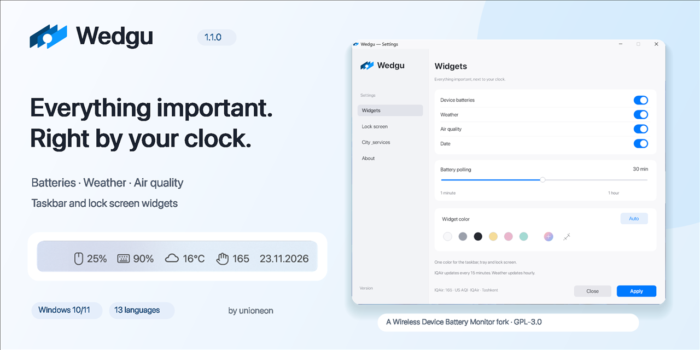
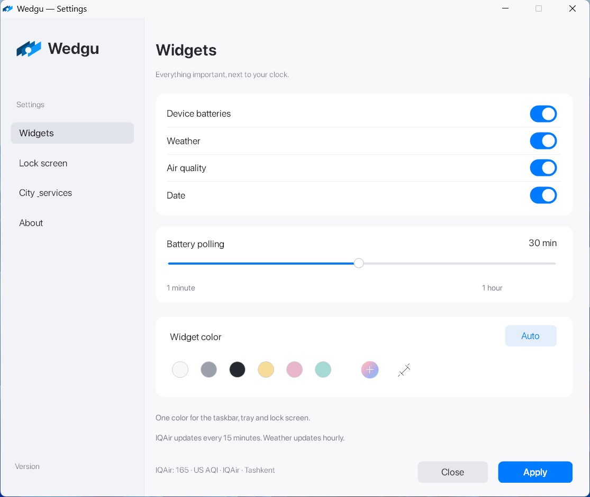
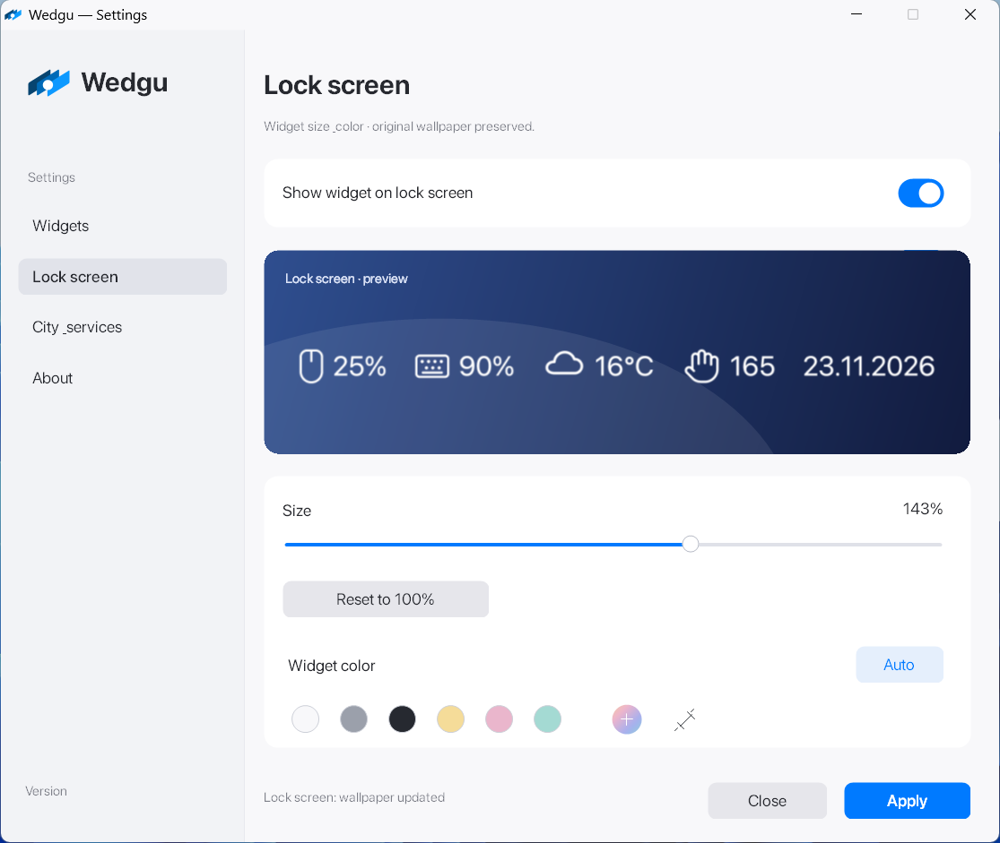
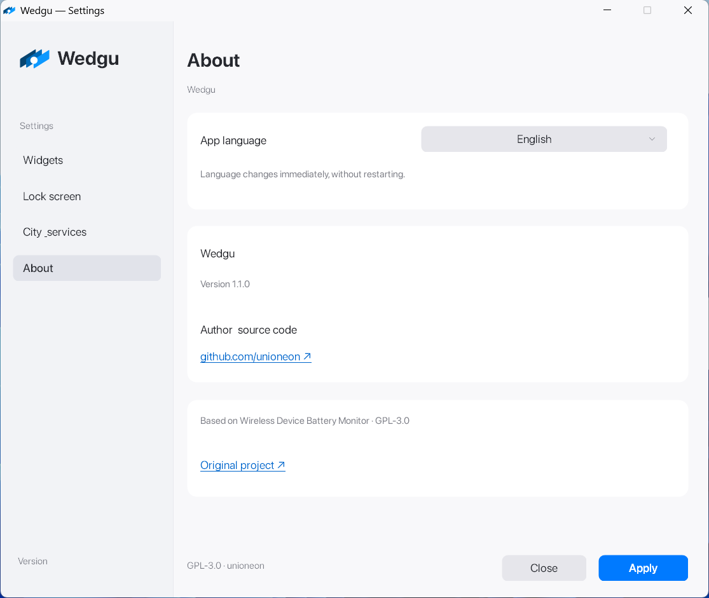
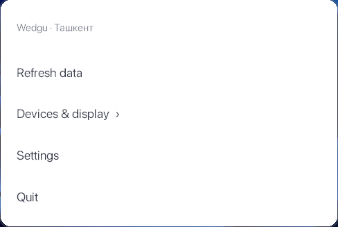
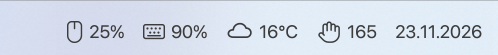
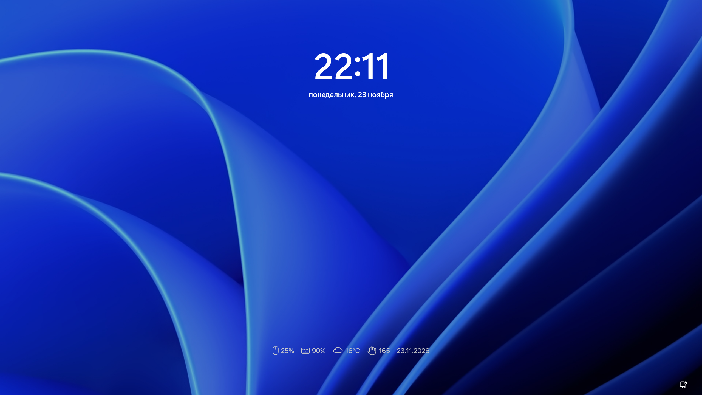

<div align="center">



[](https://github.com/unioneon/Wedgu/releases/tag/v1.1.0)


[](LICENSE)

[**Download installer**](https://github.com/unioneon/Wedgu/releases/download/v1.1.0/Wedgu-Setup-1.1.0.exe) · [**Portable ZIP**](https://github.com/unioneon/Wedgu/releases/download/v1.1.0/Wedgu-1.1.0-windows-x64-portable.zip) · [Release notes](https://github.com/unioneon/Wedgu/releases/tag/v1.1.0) · [Русский](docs/README.ru.md)

</div>

**Wedgu puts wireless device batteries, weather, air quality and the date in a compact row beside your Windows clock.** Choose the taskbar or individual tray icons, then bring the same information to your lock-screen wallpaper.

Built as a small native Windows application, with outline icons, a live appearance preview and settings in 13 languages.

## At a glance

| Feature | What you get |
|---|---|
| **Device batteries** | Mouse, keyboard, headset and controller readings, with battery polling adjustable from **1 to 60 minutes**. |
| **Weather** | **Open-Meteo without an API key**, refreshed hourly. Optional AccuWeather support with your own key and eligible plan. |
| **Air quality** | **IQAir US AQI** with custom outline status icons, refreshed every 15 minutes. Hidden entirely when no key is configured. |
| **Lock screen** | Optional wallpaper widgets, **50–200% size control**, live preview and restoration of the original background when disabled. |
| **Appearance** | One shared color for taskbar, tray and lock screen. Six presets, custom HEX colors and a screen eyedropper. |
| **Location & date** | Search for a city or detect your location through Windows. Optional system date in **DD.MM.YYYY** format, off by default. |
| **Languages** | **13 languages**, automatic system-language selection and instant switching. Arabic includes right-to-left layout. |

## A closer look

<table>
<tr><td width="50%"><strong>Your widgets, your colors</strong></td><td width="50%"><strong>A live lock-screen preview</strong></td></tr>
<tr><td></td><td></td></tr>
<tr><td>Choose what appears and how often batteries update.</td><td>Adjust the size before applying it to your wallpaper.</td></tr>
</table>

<details>
<summary><strong>Custom colors, languages and the unified menu</strong></summary>

<table>
<tr><td width="50%"><strong>Make it yours</strong></td><td width="50%"><strong>Switch languages instantly</strong></td></tr>
<tr><td></td><td></td></tr>
</table>



</details>

<p align="center"></p>

*Actual application screenshots. Battery levels, weather, AQI and date reflect the time of capture.*

## On your lock screen



**Your essentials, before you unlock.** Device battery levels, weather, air quality and the system date sit in a clean, compact row on your lock-screen wallpaper. Adjust the widget size and color in Settings, preview the result, or switch lock-screen display off entirely. Disabling it restores the original background.

*Real Windows lock-screen screenshot. Readings reflect the time of capture; the clock and date at the top are Windows system elements.*

## Get started

1. Download the [installer](https://github.com/unioneon/Wedgu/releases/download/v1.1.0/Wedgu-Setup-1.1.0.exe), or extract the complete [portable ZIP](https://github.com/unioneon/Wedgu/releases/download/v1.1.0/Wedgu-1.1.0-windows-x64-portable.zip) and run `Wedgu.exe`.
2. Right-click a widget or tray icon and open **Settings**. In **City & services**, search for your city or choose Windows location.
3. Open-Meteo weather works without a key. For air quality, add your own [IQAir API key](https://dashboard.iqair.com/personal/api-keys).
4. Choose the widgets, color and battery interval you want. Enable lock-screen display if desired, then click **Apply**.

**Auto color:** system foreground on the taskbar/tray, white on the lock screen. A custom color applies to all three. Date and color changes take effect immediately; other settings use Apply.

**Change language:** **Settings → About → App language**. The default follows the system UI language, falling back to English when unsupported. Choose English, Russian, Spanish, Simplified Chinese, French, German, Arabic, Portuguese, Japanese, Korean, Italian, Turkish or Hindi.

## Downloads and privacy

| File | Purpose |
|---|---|
| `Wedgu-Setup-1.1.0.exe` | Windows x64 installer, Start menu shortcut and uninstaller. Per-user installation is supported. |
| `Wedgu-1.1.0-windows-x64-portable.zip` | Run without installation; extract the entire archive. |
| `Wedgu-1.1.0-source.zip` | Matching application source, resources and build instructions. |
| `headsetcontrol-4.3.0.tar.gz` | Corresponding source for the bundled headset helper. |
| `SHA256SUMS.txt` | SHA-256 checksums for the release assets. |

Keep `headsetcontrol.exe` beside `Wedgu.exe` for supported USB headsets. Portable stores preferences in the Windows user profile and shares them with an installed copy. API keys are protected with **Windows DPAPI**; personal keys and settings are not included in distributions. The legacy `WirelessBattery` registry/data directory names are retained for migration.

Weather and air-quality providers receive the selected location when fetching data. Windows location detection is on demand and requires permission; it does not continuously track your location. Wallpaper backup and generated lock-screen images remain local in `%LOCALAPPDATA%\WirelessBattery`.

SF Pro Display is used when already installed. **No Apple font is redistributed.** Windows fonts provide fallback and additional script coverage.

## What changed from the original?

Wedgu is an independent fork of **[Wireless Device Battery Monitor](https://github.com/krisgfx9/Wireless-Device-Battery-Monitor)** by **[krisgfx9](https://github.com/krisgfx9)**, based on **[v1.0.4](https://github.com/krisgfx9/Wireless-Device-Battery-Monitor/releases/tag/v1.0.4)**. Its native Win32 architecture, original device support and much of the driver code come from upstream. This is a separate project release.

| Area | Changes in this fork |
|---|---|
| **Widgets & services** | Open-Meteo weather, optional IQAir/AccuWeather, system date and lock-screen wallpaper widgets. |
| **Settings** | Redesigned UI, adjustable polling and lock-screen size, shared color picker, city search, Windows location, 13 languages and About page. |
| **Visuals** | Wedgu branding, smooth outline device/weather/AQI icons, DPI-aware rendering and a custom gamepad icon. |
| **Mouse status** | A missed battery response no longer falsely marks an active mouse asleep. Cached readings are explicitly labeled. |
| **Keyboards** | Lofree Flow Lite84 receiver protocol support; AJAZZ AK820 Pro identification, USB marker handling, Bluetooth normalization and cross-transport deduplication. |
| **Quality & packaging** | Tests for translations, settings, rendering, provider responses and device protocols; installer, portable, matching sources and checksums. |

See the [changelog](CHANGELOG.md), [technical notes](LOCAL-CHANGES.md) and [archived upstream README](UPSTREAM-README.md).

## Hardware verification

| Device | Connection | Verified behavior |
|---|---|---|
| **Lofree Flow Lite84** | 2.4 GHz receiver | Battery percentage, charging flag and voltage; response and checksum validation. |
| **AJAZZ AK820 Pro** | Bluetooth | Windows battery reading, correct keyboard identity and duplicate suppression. |
| **Logitech MX Master 3S** | Logitech receiver | Battery reading; missed polls do not invent sleep. |
| **Sony WH-1000XM4** | Bluetooth | Battery reading. |
| **Xbox Wireless Controller** | Bluetooth | Battery display and the custom controller icon. |

**AJAZZ limitation:** the tested `0C45:FDFD` receiver does not supply a usable numeric percentage. The tested USB unit returns an `FF` marker, displayed as `USB`, not an invented 100%. Use Bluetooth for a percentage on that unit; other firmware revisions are unverified. Sleeping Lofree devices may need a keypress and refresh.

Windows policies may restrict location access and lock-screen wallpaper changes. The custom AQI icons change at **0–50 / 51–70 / 71+**; these are visual cues, not official IQAir health categories.

Open-Meteo's free public endpoint is intended for non-commercial use. Commercial deployments must follow the provider's current terms and use a suitable plan. IQAir and optional AccuWeather access depend on the user's credentials, plan and provider limits. Weather attribution: **Open-Meteo, CC BY 4.0**. City search: **GeoNames / Open-Meteo**.

## Build and test

Use MinGW-w64 with C++17 support (`g++`, `windres`, `make`):

```sh
make -j4
make test
node scripts/check-locales.js
```

`build.bat` is also available with MinGW on PATH. Packaging requires Inno Setup 6/7:

```powershell
./installer/build-installer.ps1
```

The packaging script produces local files, verifies the pinned HeadsetControl hashes and never uploads a release. See [CONTRIBUTING.md](CONTRIBUTING.md) for device and translation changes.

## Credits and license

**[GPL-3.0-or-later](LICENSE).** Original application: krisgfx9 and the Wireless Device Battery Monitor contributors. Wedgu development and branding: [unioneon](https://github.com/unioneon/).

HeadsetControl: Sapd and contributors, GPL-3.0. JSON for Modern C++: Niels Lohmann and contributors, MIT. Complete notices and data attribution are in [THIRD_PARTY_NOTICES.txt](installer/THIRD_PARTY_NOTICES.txt).
