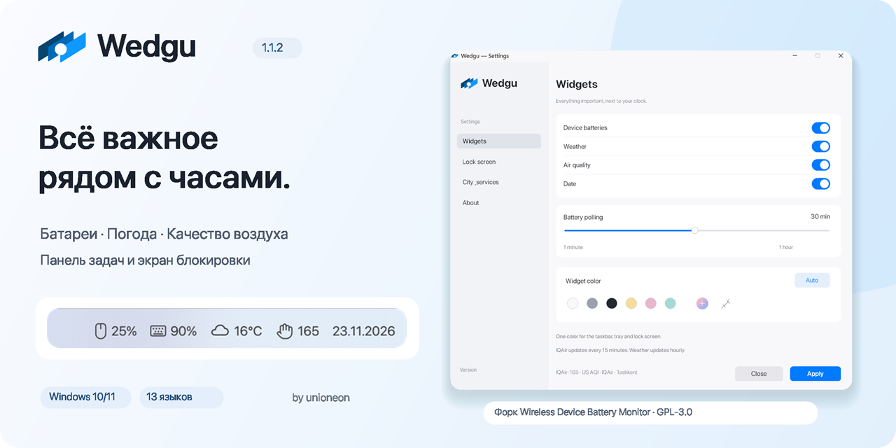
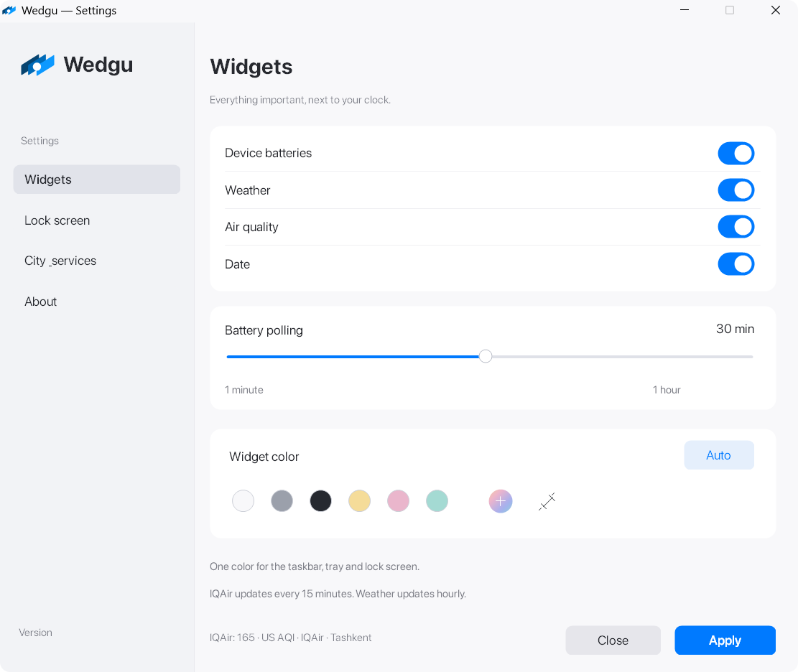
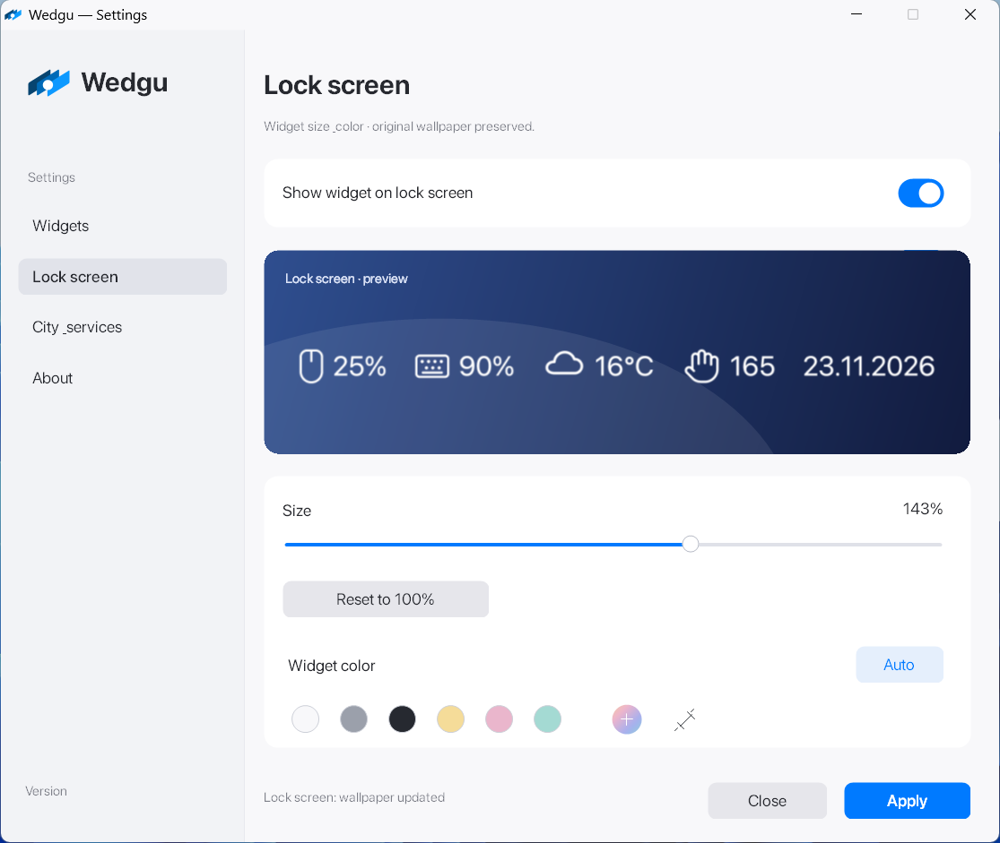
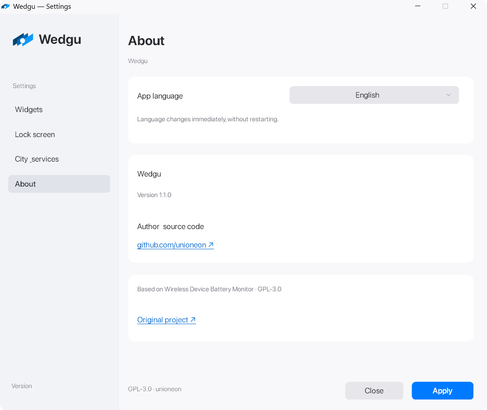
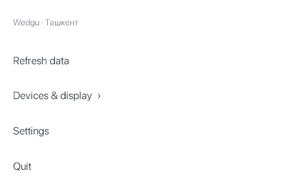
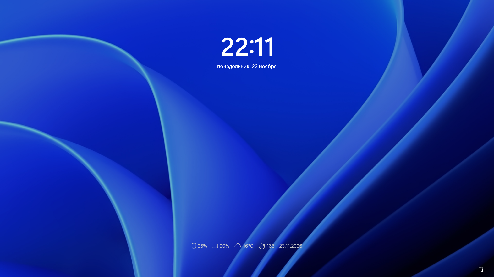

<div align="center">



[](https://github.com/unioneon/Wedgu/releases/tag/v1.1.2)

[](../LICENSE)

[**Скачать установщик**](https://github.com/unioneon/Wedgu/releases/download/v1.1.2/Wedgu-Setup-1.1.2.exe) · [**Portable ZIP**](https://github.com/unioneon/Wedgu/releases/download/v1.1.2/Wedgu-1.1.2-windows-x64-portable.zip) · [English](../README.md) · [Что нового](../CHANGELOG.md)

</div>

Wedgu — независимый форк [Wireless Device Battery Monitor](https://github.com/krisgfx9/Wireless-Device-Battery-Monitor) автора [krisgfx9](https://github.com/krisgfx9), основанный на [v1.0.4](https://github.com/krisgfx9/Wireless-Device-Battery-Monitor/releases/tag/v1.0.4). Архитектура Win32, исходная поддержка устройств и большая часть драйверов унаследованы от оригинала. Лицензия GPL-3.0-or-later сохранена; исходное описание находится в [UPSTREAM-README.md](../UPSTREAM-README.md).

## Как выглядит Wedgu

<table>
<tr><td width="50%"><strong>Виджеты и цвет</strong></td><td width="50%"><strong>Экран блокировки и размер</strong></td></tr>
<tr><td></td><td></td></tr>
<tr><td><strong>Свой цвет</strong></td><td><strong>13 языков и об авторе</strong></td></tr>
<tr><td></td><td></td></tr>
</table>

<details>
<summary>Меню программы и виджеты на панели задач</summary>




</details>

Скриншоты реальной программы. Проценты, дата и показания погоды/AQI относятся к моменту съёмки.

## На экране блокировки



**Всё нужное — ещё до разблокировки.** Заряд устройств, погода, качество воздуха и системная дата показаны аккуратной строкой на фоне локскрина. Размер и цвет можно изменить в настройках с предпросмотром, а отображение — отключить целиком. При отключении восстанавливается исходный фон.

*Реальный снимок экрана блокировки Windows. Показания относятся к моменту съёмки; верхние часы и дата — системные элементы Windows.*

## Возможности и отличия от оригинала

- Заряд мышей, клавиатур, наушников и геймпадов на панели задач или отдельными значками в трее.
- Погода Open-Meteo без регистрации и API-ключа, обновление раз в час. Дополнительно можно выбрать AccuWeather со своим ключом и подходящим тарифом.
- Качество воздуха IQAir с личным API-ключом, обновление раз в 15 минут. Без ключа виджет полностью скрыт. [Получить ключ IQAir](https://dashboard.iqair.com/personal/api-keys).
- Системная дата в формате `ДД.ММ.ГГГГ`, после качества воздуха; по умолчанию выключена.
- Настраиваемый интервал опроса батарей от 1 до 60 минут.
- Виджеты на фоне экрана блокировки: включение, размер 50–200%, живой предпросмотр и восстановление исходного фона при отключении. Отображение зависит от поддержки изменения фона политиками Windows.
- Общий цвет для панели задач, трея и локскрина: шесть заготовок, произвольный цвет, HEX и пипетка. Режим «Авто» использует системный цвет на панели/в трее и белый на локскрине.
- Поиск города по названию или определение местоположения через Windows по запросу. Координаты не нужно вводить. Для геолокации требуется разрешение Windows; она не отслеживается непрерывно.
- Единое меню, новые настройки, логотип Wedgu и сглаженные контурные иконки погоды и устройств.
- 13 языков интерфейса: английский, русский, испанский, упрощённый китайский, французский, немецкий, арабский, португальский, японский, корейский, итальянский, турецкий и хинди. По умолчанию — язык интерфейса системы, для неподдерживаемых языков — английский. Меняется в **Настройки → О программе** без перезапуска; арабский использует расположение справа налево.
- SF Pro Display используется, если уже установлен на компьютере. Шрифт не распространяется с программой; для дополнительных письменностей и при отсутствии SF Pro используются шрифты Windows.
- Исправлено ложное состояние сна мыши после пропущенного ответа. Добавлены драйверные доработки Lofree Flow Lite84 и AJAZZ AK820 Pro.

Пороговые иконки AQI: 0–50 — палец, 51–70 — смайлик, от 71 — рука. Это пользовательские визуальные обозначения, а не официальные категории здоровья IQAir.

## Установка

- `Wedgu-Setup-1.1.2.exe`: установщик, ярлык в меню «Пуск», удаление через Windows. По умолчанию доступна установка для текущего пользователя.
- `Wedgu-1.1.2-windows-x64-portable.zip`: распакуйте целиком и запустите `Wedgu.exe`. Оставьте `headsetcontrol.exe` рядом для поддерживаемых USB-наушников.
- `Wedgu-1.1.2-source.zip`: соответствующие исходники приложения. Исходники HeadsetControl поставляются отдельным архивом.
- `SHA256SUMS.txt`: контрольные суммы файлов релиза.

Portable запускается без установки, но настройки хранятся в профиле Windows и общие с установленной копией. Ключи сервисов шифруются Windows DPAPI. В дистрибутивах нет пользовательских ключей, координат профиля и персональных настроек.

Правый клик по виджету или иконке открывает меню. Настройте город и при необходимости добавьте свой IQAir-ключ. Фон локскрина и его резервная копия хранятся локально в `%LOCALAPPDATA%\WirelessBattery`; имя каталога и реестра сохранено для совместимости с прежней версией.

Бесплатный публичный endpoint Open-Meteo предназначен для некоммерческого использования. Для коммерческого применения проверьте условия сервиса и подходящий тариф. Источник погоды: Open-Meteo, CC BY 4.0. Поиск городов: GeoNames / Open-Meteo.

## Проверенные устройства и ограничения

| Устройство | Подключение | Результат |
|---|---|---|
| AJAZZ AK980 V2 | Приёмник 2,4 ГГц | Пользователь подтвердил чтение заряда в тестовой сборке. |
| Lofree Flow Lite84 | Приёмник 2,4 ГГц | Чтение процента, флага зарядки и напряжения; проверка ответов и контрольной суммы. |
| AJAZZ AK820 Pro | Bluetooth | Чтение процента через Windows, правильное имя и устранение дублей разных подключений. |
| WLMouse Beast X | Приёмник 1K `36A7:A882` | Чтение заряда подтверждено автором PR; переключение приёмник/кабель без дублей и зарядка покрыты автоматическими тестами. |
| Logitech MX Master 3S | Logitech receiver | Чтение заряда; пропуск опроса не объявляет мышь спящей. |
| Sony WH-1000XM4 | Bluetooth | Чтение заряда. |
| Xbox Wireless Controller | Bluetooth | Отображение заряда и новой векторной иконки. |

Проверенный приёмник AJAZZ `0C45:FDFD` не выдаёт пригодный числовой процент; запросы к нему не означают поддержку процента. USB проверенного экземпляра возвращает маркер `FF`, который показывается как `USB`, а не выдуманные 100%. Для процента этого экземпляра используйте Bluetooth. Другие прошивки не подтверждены. Спящую Lofree может потребоваться разбудить нажатием клавиши и обновить данные. Сохранённые значения явно помечаются в подсказке.

## Нужна поддержка вашего устройства?

**Добавление поддержки — $5 за устройство.** Если вашей мыши, клавиатуры, гарнитуры или геймпада ещё нет в Wedgu, я могу добавить поддержку. Напишите [@mansdesigner в Telegram](https://t.me/mansdesigner), указав точную модель и способ подключения, чтобы обсудить доработку.

Готовая поддержка устройства войдёт в **публичную версию Wedgu с открытым исходным кодом** и станет доступна всем владельцам этой модели.

## Сборка

Нужен MinGW-w64 с поддержкой C++17 (`g++`, `windres`, `make`). Сетевые функции используют WinHTTP; JSON-библиотека включена в `vendor/`.

```sh
make -j4
make test
```

Из PowerShell с MinGW в PATH можно использовать `build.bat`. Для упаковки установите Inno Setup 6/7 и выполните:

```powershell
./installer/build-installer.ps1
```

Скрипт создаёт локальные пакеты, проверяет хеши HeadsetControl и не публикует их. Не передавайте личные настройки и ключи вместе с релизом.

## Лицензии и благодарности

[GPL-3.0-or-later](../LICENSE). Оригинальный проект: krisgfx9 и участники Wireless Device Battery Monitor. Развитие форка и бренд Wedgu: [unioneon](https://github.com/unioneon/). HeadsetControl — Sapd и участники, GPL-3.0. JSON for Modern C++ — Niels Lohmann и участники, MIT. Полные сведения — [THIRD_PARTY_NOTICES.txt](../installer/THIRD_PARTY_NOTICES.txt).

Драйвер WLMouse добавлен [arsants](https://github.com/arsants) на основе GPL-драйвера оригинального проекта. Старый Beast X 4K (`A887` / `A888`) использует другой протокол и не поддерживается этим драйвером; остальные варианты WLMouse здесь на устройствах не проверялись.
