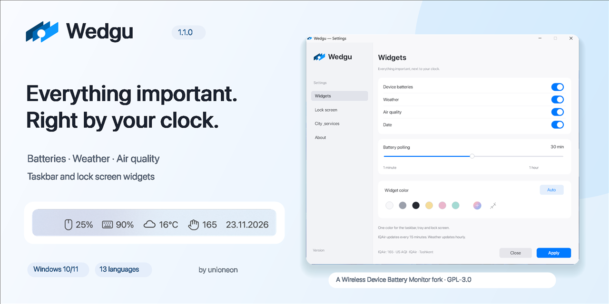
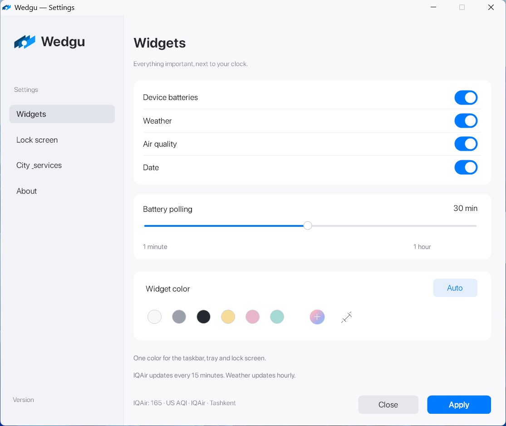
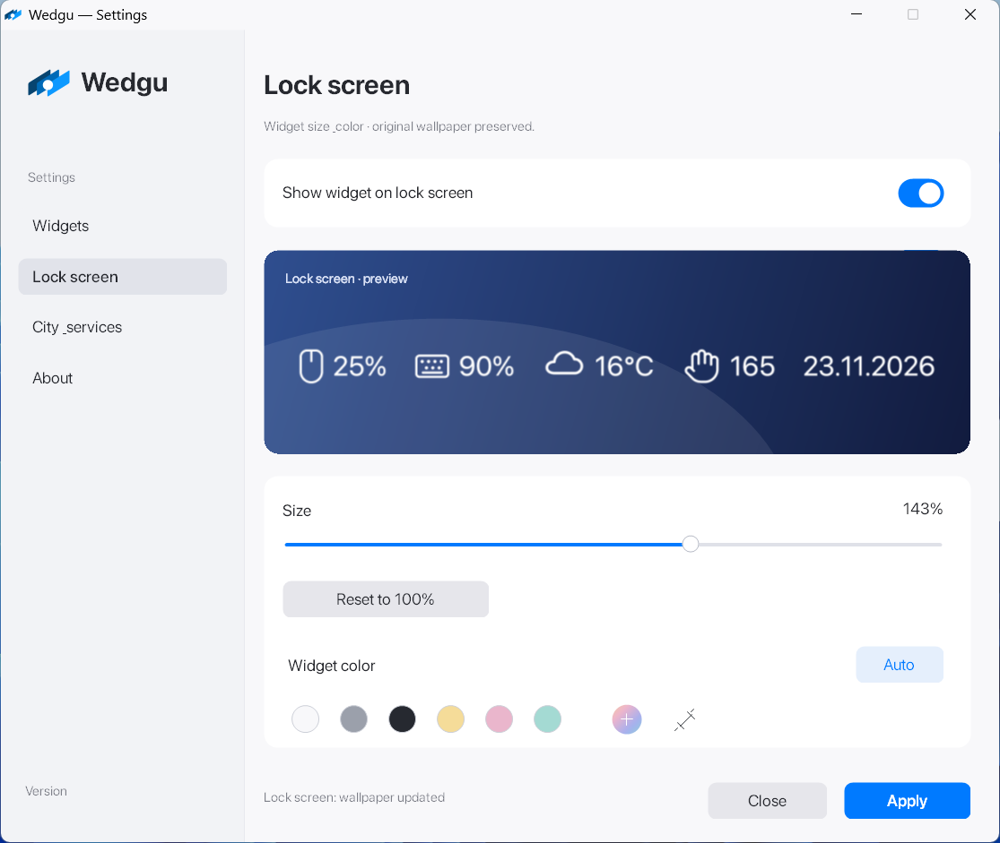
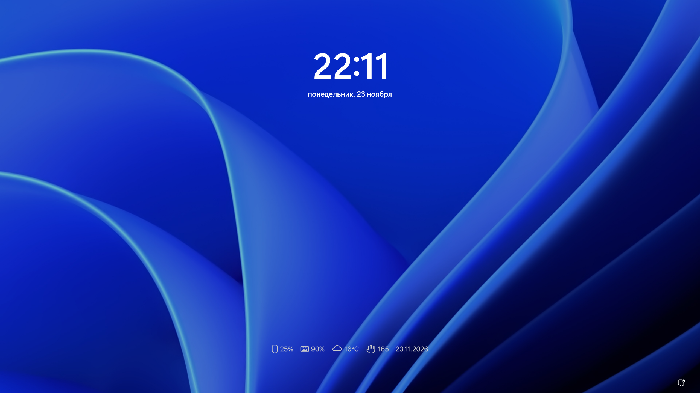

# Wedgu 1.1.0

**Everything important. Right by your clock.**

Device batteries, weather, air quality and the date in native Windows taskbar and lock-screen widgets. This release introduces the **Wedgu** name, redesigned settings and 13 interface languages.

[Download installer](https://github.com/unioneon/Wedgu/releases/download/v1.1.0/Wedgu-Setup-1.1.0.exe) · [Download portable](https://github.com/unioneon/Wedgu/releases/download/v1.1.0/Wedgu-1.1.0-windows-x64-portable.zip) · [Full documentation](https://github.com/unioneon/Wedgu#readme) · [Русский](https://github.com/unioneon/Wedgu/blob/v1.1.0/docs/README.ru.md)

## What's new

| Feature | In this release |
|---|---|
| **Weather** | Open-Meteo without registration or an API key; hourly refresh. Optional AccuWeather with your own key and eligible plan. |
| **Air quality** | IQAir US AQI with custom outline icons and 15-minute refresh. Hidden completely until you add your own key. |
| **Lock screen** | Optional wallpaper widgets, a 50–200% size slider, live preview and original-background restoration. |
| **Appearance** | One color across taskbar, tray and lock screen; six presets, HEX picker and screen eyedropper. Auto uses system foreground and a white lock-screen widget. |
| **Battery polling** | Adjustable from 1 minute to 1 hour. |
| **City & date** | City-name search or on-demand Windows location. Optional system date, disabled by default, shown after AQI. |
| **Languages** | English, Russian, Spanish, Simplified Chinese, French, German, Arabic, Portuguese, Japanese, Korean, Italian, Turkish and Hindi. System-language default, instant switching and Arabic RTL layout. |
| **Interface** | Redesigned settings, unified menus, outline weather icons, Wedgu branding and an About page linking to the author and upstream project. |

<table>
<tr><td width="50%"><strong>Widget settings</strong></td><td width="50%"><strong>Lock-screen preview</strong></td></tr>
<tr><td></td><td></td></tr>
</table>

*Real screenshots; readings reflect the time of capture.*

## On your lock screen

**Your essentials, before you unlock.** Battery levels, weather, air quality and the system date appear as a compact row on your lock-screen wallpaper. Customize the size and color with live preview, or disable the display and restore the original background. The clock and date at the top are Windows system elements.

## Fixes and retained improvements

- Missed battery replies no longer falsely mark an active mouse asleep. Cached readings remain explicitly identified.
- Custom colors update taskbar, tray and lock-screen widgets consistently; the date toggle takes effect immediately.
- Sliders repaint without ghost thumbs; toggles, password fields and popup menus use consistent rendering.
- Windows-style device icons, the custom controller icon, Lofree Flow Lite84 receiver support and AJAZZ Bluetooth identity/deduplication improvements from the previous fork release are retained.
- Regression coverage includes embedded translations, system-language mapping, edit preservation, RTL layout bounds, slider painting, date/color updates, provider parsing, all 44 weather condition codes at five DPI levels, and device protocols.

## Install

For Windows 10/11 **x64**, use `Wedgu-Setup-1.1.0.exe`, or extract the entire portable ZIP and run `Wedgu.exe`. Keep `headsetcontrol.exe` beside it for supported USB headsets.

Open **Settings → City & services**, choose your city and optionally add your personal [IQAir key](https://dashboard.iqair.com/personal/api-keys). Change the interface language in **Settings → About**.

Portable uses the Windows user profile for settings. API keys are encrypted with Windows DPAPI; **no personal keys or profiles are bundled**. SF Pro Display is used only if already installed, and is not redistributed.

## Files

- **Setup EXE** — Windows installer and uninstaller.
- **Portable ZIP** — application, headset helper and license notices.
- **Source ZIP** — corresponding application sources, resources, screenshots and build instructions.
- **HeadsetControl source** — matching source for the bundled GPL helper.
- **SHA256SUMS.txt** — checksums for the release files.

## Hardware and service notes

- The tested **AJAZZ AK820 Pro** receiver supplies no usable battery percentage; use Bluetooth. Its USB marker is not a measured 100%.
- Sleeping devices may need to be woken before their battery can be read.
- Windows permissions or policies can restrict location and lock-screen wallpaper changes.
- Open-Meteo's free public endpoint is for non-commercial use. Provider terms and limits apply. IQAir and optional AccuWeather use user-supplied credentials.
- AQI icon thresholds are custom visual cues, not official health categories.

## Upstream and credits

Wedgu is an **independent fork** of [Wireless Device Battery Monitor](https://github.com/krisgfx9/Wireless-Device-Battery-Monitor) by [krisgfx9](https://github.com/krisgfx9), based on **v1.0.4**. Its native Win32 architecture and much of its battery-device support come from that project. **GPL-3.0-or-later attribution is preserved.**

Wedgu development and branding: [unioneon](https://github.com/unioneon/). HeadsetControl: Sapd and contributors. Weather: Open-Meteo, CC BY 4.0; city search: GeoNames / Open-Meteo. JSON for Modern C++: Niels Lohmann and contributors, MIT. See the included third-party notices and [changelog](https://github.com/unioneon/Wedgu/blob/v1.1.0/CHANGELOG.md).
