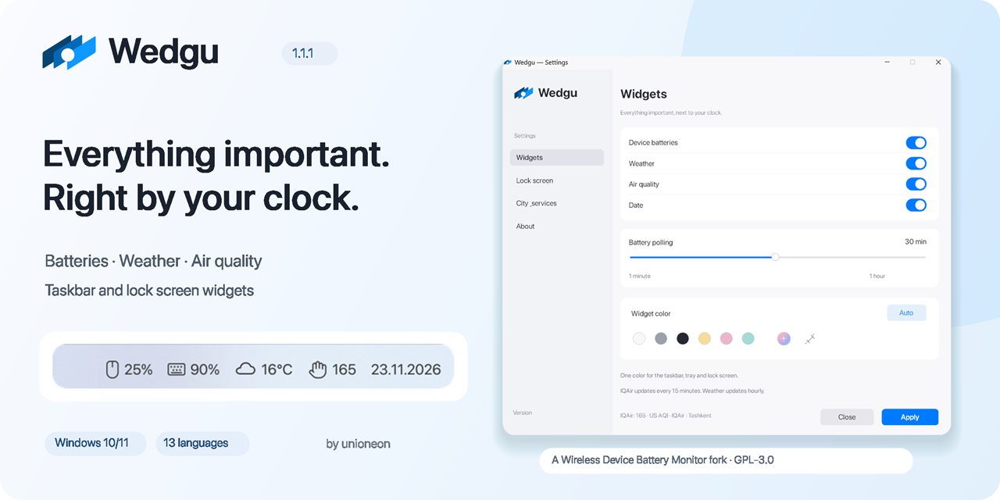

# Wedgu 1.1.1 — AJAZZ AK980 V2 support

**AJAZZ AK980 V2 battery monitoring over its 2.4 GHz receiver is now supported.** A user confirmed that it works on the test build.

[Download installer](https://github.com/unioneon/Wedgu/releases/download/v1.1.1/Wedgu-Setup-1.1.1.exe) · [Portable ZIP](https://github.com/unioneon/Wedgu/releases/download/v1.1.1/Wedgu-1.1.1-windows-x64-portable.zip) · [Documentation](https://github.com/unioneon/Wedgu#readme)

## What's changed

- **AK980 V2, 2.4 GHz:** implemented battery queries for the known 33-byte SONiX receiver protocol. Replies are checked before accepting a percentage.
- **Newer AK980 Pro revisions:** added a separate 65-byte GET_DEVICE_INFO path, with header, command, model-ID, mode and battery-range validation. This path is experimental and covered by fixture tests; it has not been hardware-confirmed in this project.
- **Bluetooth identity:** AK980 devices are classified as keyboards and merged with USB/receiver entries when Windows provides battery data.
- **USB identity:** shared product IDs use the actual device name, preventing AK980 from being displayed as AK820. Older wired firmware is shown as USB rather than an invented 100%.
- **Regression coverage:** tests for malformed replies, wrong device IDs, out-of-range percentages, unrelated HID collections and duplicate suppression. Existing AJAZZ, Lofree and Rapoo checks pass.

Weather, IQAir, lock-screen widgets, custom colors, the optional system date and all 13 interface languages remain available.

## Install or update

Use **Wedgu-Setup-1.1.1.exe**, or extract the complete portable ZIP and run **Wedgu.exe** after quitting the previous copy. Keep **headsetcontrol.exe** alongside it for supported USB headsets. Windows 10/11 x64 is required.

Settings remain in the Windows user profile. Personal API keys and settings are not bundled. The release includes application source, HeadsetControl corresponding source and SHA-256 checksums.

## Compatibility notes

The user-confirmed result is **AK980 V2 over 2.4 GHz**. Other AK980 revisions may use different firmware or device IDs. Sleeping keyboards may need a keypress and a refresh. Bluetooth percentages depend on Windows exposing battery data.

The previous AJAZZ AK820 Pro limitation remains: the tested receiver does not provide a usable percentage; use Bluetooth on that unit. Do not interpret a USB marker as measured charge.

## Credits

Wedgu is an independent **GPL-3.0-or-later** fork of [Wireless Device Battery Monitor](https://github.com/krisgfx9/Wireless-Device-Battery-Monitor) by [krisgfx9](https://github.com/krisgfx9), based on v1.0.4. Wedgu development: [unioneon](https://github.com/unioneon/).

AK980 protocol references: [SONiX receiver documentation](https://github.com/donglover69/sonix-keyboard-studio/blob/main/src/Sonix.Keyboard/SonixDongle.cs) and [newer firmware hardware report](https://github.com/wushuai0802/myfinder-device-battery/issues/966). Third-party licenses and data attribution remain included in the packages.
