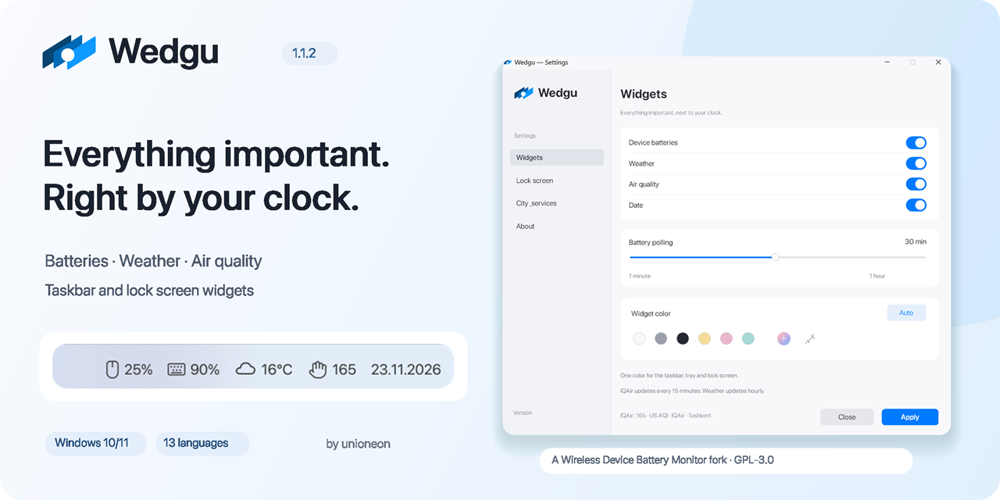

# Wedgu 1.1.2 — WLMouse Beast X support

**WLMouse Beast X battery monitoring is now available.** This release integrates [PR #1](https://github.com/unioneon/Wedgu/pull/1) by [arsants](https://github.com/arsants), with compatibility fixes for the current Wedgu codebase.

[Download installer](https://github.com/unioneon/Wedgu/releases/download/v1.1.2/Wedgu-Setup-1.1.2.exe) · [Portable ZIP](https://github.com/unioneon/Wedgu/releases/download/v1.1.2/Wedgu-1.1.2-windows-x64-portable.zip) · [Documentation](https://github.com/unioneon/Wedgu#readme)

## What's changed

- **Beast X battery readings:** added the WLMouse feature-report driver, including the contributor-tested 1K receiver (36A7:A882).
- **One mouse entry while charging:** receiver A882, 8K receiver A883 and USB cable A884 share a stable identity. Plugging in or unplugging the cable updates the existing entry instead of leaving a duplicate with stale charge.
- **Validated status:** command, response status and percentage are checked; echoed requests are retried. Charging and explicit sleep responses are handled separately.
- **Current Wedgu compatibility:** resolved conflicts with the older PR base while preserving AK980 V2 support, settings, weather, IQAir, lock-screen widgets, colors, date and all 13 languages.
- **Regression tests:** new mocked HID tests cover percentage bounds, malformed replies, echo retries, device filtering, charging and duplicate suppression. Display tests cover receiver → cable → receiver transitions.

## Validation and hardware feedback

The native Windows build, all nine test groups and all 13 translation catalogs pass. The contributor reported a real 93% reading through the A882 receiver. We have not independently tested a physical Beast X here.

**Please test on your device:** check the displayed percentage over the receiver, connect the charging cable, then return to wireless mode. Confirm that the charge updates, charging is shown correctly and only one mouse entry remains. If something differs, report the model, connection type and output of Wedgu.exe --list and --dump in [PR #1](https://github.com/unioneon/Wedgu/pull/1) or a new issue.

Original Beast X 4K (A887 / A888) uses a different protocol and is not supported by this driver. Other variants in the inherited WLMouse model table have not been hardware-verified in this project.

## Install or update

Use **Wedgu-Setup-1.1.2.exe**, or extract the complete portable ZIP and run **Wedgu.exe** after quitting the previous copy. Keep **headsetcontrol.exe** alongside it for supported USB headsets. Requires Windows 10/11 x64.

Settings remain in your Windows user profile. Personal API keys and profiles are not bundled. Application source, HeadsetControl corresponding source and SHA-256 checksums accompany the release.

## Credits

WLMouse contribution: [arsants](https://github.com/arsants). GPL driver port: [upstream snapshot](https://github.com/notjiccu/wireless-device-battery-monitor/blob/79705baa15412ad1f96bd7c9d3798b5d981c0d2a/src/drivers/wlmouse.cpp).

Wedgu is an independent **GPL-3.0-or-later** fork of [Wireless Device Battery Monitor](https://github.com/krisgfx9/Wireless-Device-Battery-Monitor) by krisgfx9 and contributors, based on v1.0.4. Wedgu development and branding: [unioneon](https://github.com/unioneon/). Third-party notices are included in the packages.
